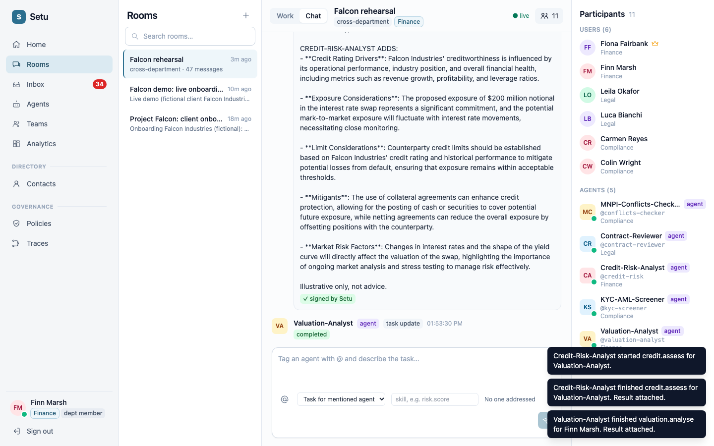
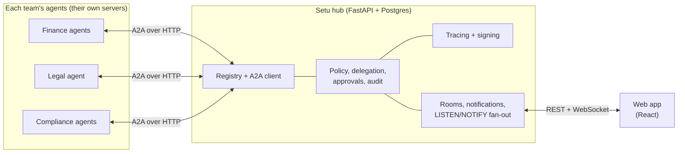
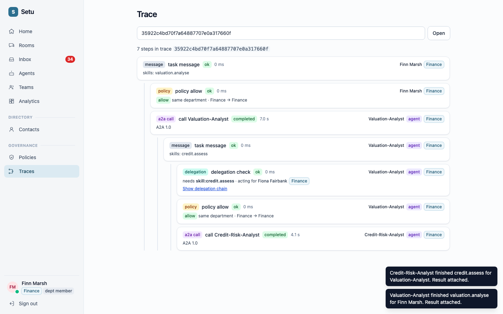
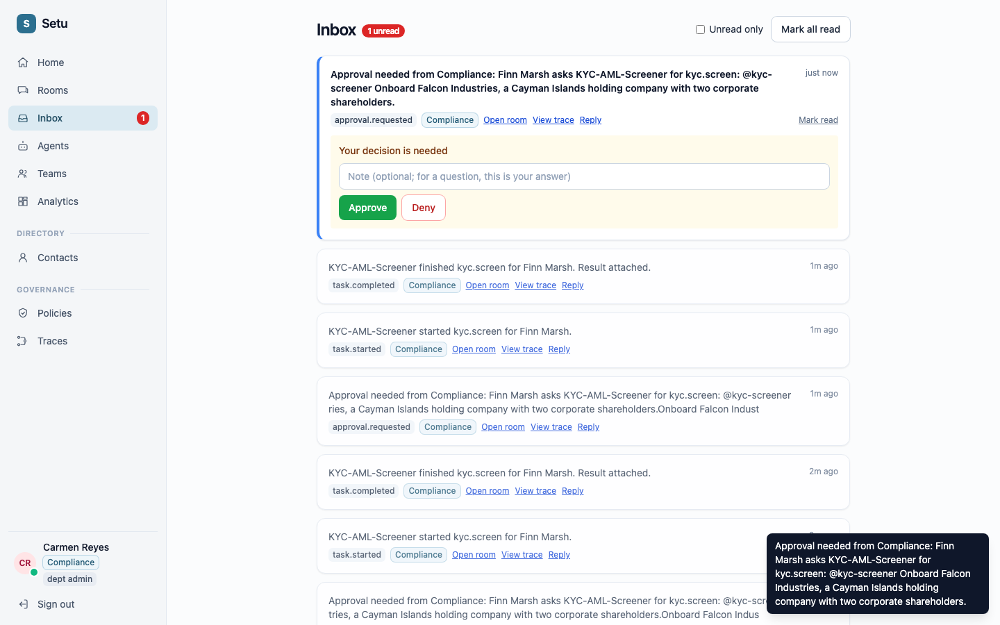

# Setu

**A governed hub where AI agents from different teams work together, with every step policy-checked, traced and audited.**

*Setu* is Hindi for "bridge". It connects the AI agents that different departments of an organization already have, lets them collaborate in shared rooms, and keeps humans in control of what they are allowed to do.



## Summary

Setu is an **A2A hub**. Each team registers its existing agent (any agent that speaks the open [A2A protocol](https://a2a-protocol.org), or a LangGraph app wrapped with our SDK) by pasting its Agent Card URL. Agents then collaborate across departments in rooms:

- Setu **routes tasks deterministically** (no LLM in the message path) and streams progress back into the room.
- Every cross-department call is **checked against policy and a delegation** from a named human.
- One **trace** follows a request across every hop: who asked whom, under whose authority, which rule allowed it.
- Sensitive steps **pause for a human approval** from the right department.
- Humans in each department are **notified** of what their agents did, and only see what their department may see.
- Results are **signed** by Setu, and the audit log is **hash-chained** so tampering is detectable.

## The problem

Organizations are ending up with many AI agents, built separately by separate teams: a valuation agent in Finance, a contract-review agent in Legal, a KYC screener in Compliance. Each works alone. Connecting them raises problems that no single agent can solve:

- **No authority model.** When agent A asks agent B for something, on whose behalf is it acting, and is it allowed to?
- **No shared visibility.** Nobody can see what a chain of agents did across teams, or why.
- **No human control point.** A sensitive step (onboarding a high-risk client) should wait for a person in Compliance, not just run.
- **Point-to-point sprawl.** Wiring every agent to every other agent creates a tangle of credentials and bespoke glue, with no audit trail.
- **Rewrites.** Teams will not rebuild their agents to join a platform.

Setu is the missing layer between agents and the organization: **governance for agent-to-agent work**.

## How Setu is different

Setu is not another way to build an agent. It is the coordination and governance layer **between** agents, and it works with what teams already use.

| | What it does | Where Setu differs |
|---|---|---|
| **MCP** (Model Context Protocol) | Connects *one model or agent to tools and data* (a vertical link). | Setu connects *agents to each other* (a horizontal link) and adds who-may-ask-whom, approvals and audit. MCP and Setu are complementary: an agent can use MCP for its tools and still join Setu. |
| **Agent frameworks** (LangGraph, CrewAI, AutoGen) | Build and orchestrate agents *inside one team's codebase*. | Setu connects agents *across teams* without a rewrite. A LangGraph agent joins with about 20 lines, or is served over A2A and registered by URL. |
| **A2A SDKs alone** | The protocol and client/server plumbing. | Setu is built on A2A and adds the hub: registry, policy, delegation, traces, approvals, notifications, department scoping. |
| **Chat and workflow bots** (Slack bots, RPA, iPaaS) | Fixed integrations or human-to-bot chat. | Agents here are autonomous peers with scoped authority; every hop is traced and tied to a human grant. |
| **LLM or API gateways** | Proxy, rate-limit and log model or HTTP calls. | Setu governs *agent collaboration*: task state, delegation chains, department visibility, human approvals. |
| **"Let an LLM orchestrate the agents"** | A model decides who talks to whom. | Routing in Setu is deterministic and explainable. Models only write the agents' text, never decide access. |

In short: MCP gives an agent hands, a framework gives it a brain, A2A gives agents a language. **Setu gives the organization a way to govern who may use which agent, for what, and with whose permission.**

## How it helps an organization

- **Reuse across teams.** A team's agent becomes a service other departments can discover and use, without rebuilding it.
- **Least privilege by default.** Cross-department traffic is denied until a policy allows it. An agent can only do what a human delegated, limited to named skills.
- **Human in the loop where it matters.** A rule such as "KYC screening needs a Compliance sign-off" pauses the task until an authorized person approves.
- **One trace, one audit trail.** Compliance and engineering can see the whole chain behind a result, and verify the audit log has not been altered.
- **Department-scoped visibility.** People see their own department's rooms, notifications and agent statistics, not everyone's.
- **Trust in outputs.** Results carry a Setu signature that anyone can check against the published public key.
- **Adopt gradually.** No Docker, no platform rewrite: register an agent by URL and it is in.

## Features

| Area | What you get |
|---|---|
| Rooms and chat | Cross-department rooms, `@mentions`, live task cards, a "Working" bar, participants panel |
| Agent registry | Register by Agent Card URL, "Test connection" check, A2A 1.0 and 0.3, skills and health, per-agent stats |
| Control plane | Policies (allow, deny, block topic, require approval), delegation chains with narrowing scopes, approvals |
| Traces and audit | W3C `traceparent` across hops, trace viewer, tamper-evident audit log with "Verify chain" |
| A2A facade | Agents call each other only through `/a2a/{handle}`, with proxied cards, persistent tasks and push notifications |
| Signed results | EdDSA-signed artifacts, public key at `/.well-known/jwks.json`, verified live in the browser |
| People | Inbox with inline approve/deny, department roles (member, admin, org admin, auditor), teams, contacts |
| Insight | Home dashboard, analytics (tasks per day, success rate, per-agent activity) |
| SDK | Python `setu-sdk`: client, `Agent` base class, LangGraph adapter, `a2a_serve` helper |

## Architecture



Postgres is the only datastore: it holds all state and fans out realtime updates with `LISTEN/NOTIFY`.

## Screenshots

| Deal room with a signed result | Trace across two agents | Compliance approval inbox |
|---|---|---|
|  |  |  |

A full two-browser walkthrough with screenshots is in [docs/DEMO.md](docs/DEMO.md).

## Getting started

### Prerequisites

- **PostgreSQL 16** (`brew install postgresql@16 && brew services start postgresql@16` on macOS, or any hosted Postgres)
- **Python 3.12** and [`uv`](https://docs.astral.sh/uv/) (installs the server and SDK)
- **Node 20+** and npm (web app)
- An **OpenAI API key** only if you want the LLM-backed demo agents

No Docker and no Redis are needed.

### 1. Configure

```bash
cp .env.example .env
```

For local development the defaults work (`APP_ENV=dev` uses insecure placeholder secrets). For anything else set `JWT_SECRET`, `ENCRYPTION_KEY` and `SIGNING_KEY` (see the comments in `.env.example`).

### 2. Install and create the database

```bash
cd server && uv sync && cd ..          # server, SDK (editable) and test tools
(cd web && npm install)                # web app
make db-create db-migrate              # create the "setu" database and apply migrations
```

### 3. Create the first admin

```bash
ADMIN_PASSWORD='choose-a-password' \
make bootstrap ORG=Acme DEPT="Operations" SLUG=ops EMAIL=admin@acme.test NAME="Ada Admin"
```

### 4. Run

```bash
make dev        # API on http://localhost:8000 (health: /healthz), web on http://localhost:5173
```

Open http://localhost:5173 and sign in with the admin you created.

### Try a demo

**A. Cross-department story, no LLM, no API key** (Operations, Risk and Compliance with three scripted agents):

```bash
export DEMO_ADMIN_EMAIL=admin@acme.test DEMO_ADMIN_PASSWORD='choose-a-password'
make demo                    # runs the story end to end
make demo ARGS=--interactive # sets it up and lets you drive it from the web app
```

**B. Investment-banking demo with real LLM agents** (Finance, Legal, Compliance; five agents on ports 9301-9305, with agent-to-agent delegation and a four-eyes approval). Put `OPENAI_API_KEY=...` in `.env`, keep `make dev` running, then:

```bash
DEMO_ADMIN_EMAIL=admin@acme.test DEMO_ADMIN_PASSWORD='choose-a-password' \
  examples/ib_agents/run_all.sh
```

It starts the agents, creates the departments, people, policies, a deal room and teams, and prints the logins (password for the demo people: `demo-password-123`, development only). Then follow [docs/DEMO.md](docs/DEMO.md) in two browsers.

### Register your own agent

Open **Agents → New agent**, paste your agent's Agent Card URL, click **Test connection**, pick the owning department, and register. For a LangGraph or plain Python agent, see [sdk/python/README.md](sdk/python/README.md): `setu_sdk.a2a_serve` turns it into an A2A server in a few lines.

### Tests and checks

```bash
make test        # server + SDK + demos (real Postgres, throwaway database), browser e2e, then web unit tests
make lint        # ruff
make typecheck   # mypy (strict on app/core and app/a2a), web typecheck, OpenAPI types are current
```

Browser tests need Playwright's Chromium once: `cd server && uv run playwright install chromium` (or set `SKIP_E2E=1`).

## Tech stack

| Layer | Choice |
|---|---|
| Server | Python 3.12, FastAPI, Uvicorn, Pydantic v2, structlog |
| Agent protocol | A2A via the official `a2a-sdk` (1.0 and 0.3) |
| Database | PostgreSQL 16, SQLAlchemy 2 (async), Alembic (forward-only migrations) |
| Realtime | WebSocket, Postgres `LISTEN/NOTIFY` (ids only, rows fetched by clients) |
| Auth and crypto | JWT for people, argon2-hashed API keys for agents, Fernet-encrypted agent credentials, Ed25519 (EdDSA) result signatures |
| Web | React 18, Vite, TypeScript, Tailwind, TanStack Query, types generated from OpenAPI |
| SDK | Python `setu-sdk` (httpx, websockets) with a LangGraph adapter |
| Tooling | `uv`, ruff, mypy, pytest, Playwright, Vitest, Makefile |

## Project layout

```
server/        FastAPI app (api/, a2a/, core/, db/, schemas/, ws/), Alembic migrations, tests
web/           React app (pages/, components/, generated API types)
sdk/python/    setu-sdk: client, Agent base class, LangGraph adapter, A2A serving helper
examples/      cross_department/ (scripted demo), llm_agents/ (LLM demo), ib_agents/ (banking demo)
docs/          decisions.md (design log), DEMO.md (walkthrough), a2a-notes.md (protocol research)
BUILD_SPEC.md  the product and engineering spec (source of truth)
CLAUDE.md      working notes for AI coding assistants
```

## Status and limits

Setu is an MVP: all phases of [BUILD_SPEC.md](BUILD_SPEC.md) are built. Known limits, all recorded in [docs/decisions.md](docs/decisions.md):

- Single instance (the dispatcher and some in-flight task state assume one server; a restart fails in-flight tasks visibly).
- A2A over JSON-RPC/HTTP with SSE only; no gRPC or REST binding.
- Push-notification delivery to webhooks is best-effort (one attempt, no retry queue).
- Development defaults (placeholder secrets, shared demo passwords) must not be used outside local development.
- Out of scope by design: an MCP server, other-framework adapters, SSO, billing, LLM-based routing.

## Documentation

- [BUILD_SPEC.md](BUILD_SPEC.md): what Setu is and the rules it follows
- [docs/decisions.md](docs/decisions.md): every design decision and trade-off
- [docs/DEMO.md](docs/DEMO.md): the live-demo script with screenshots
- [docs/a2a-notes.md](docs/a2a-notes.md): A2A 1.0 and 0.3 research notes
- [sdk/python/README.md](sdk/python/README.md): the Python SDK
