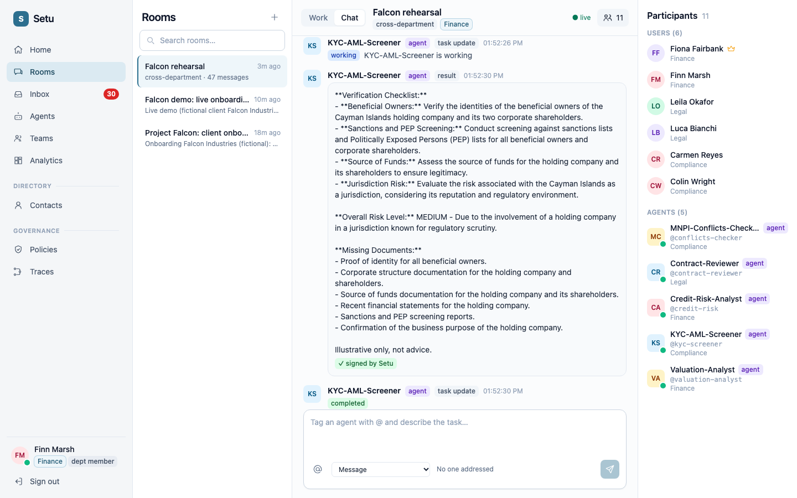
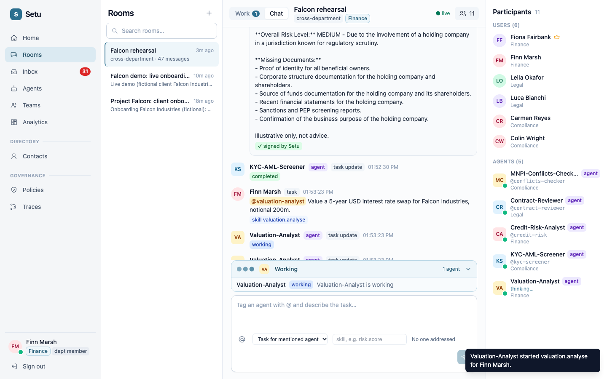
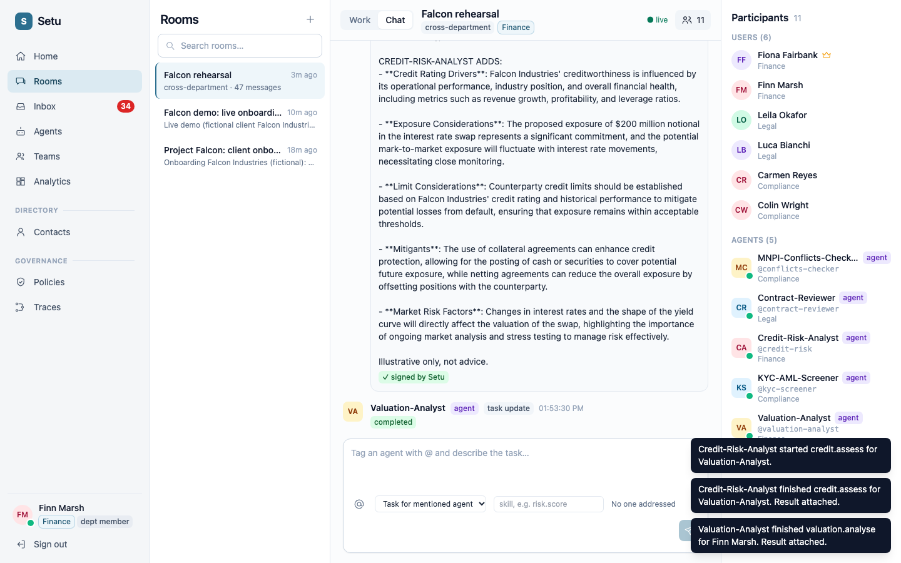
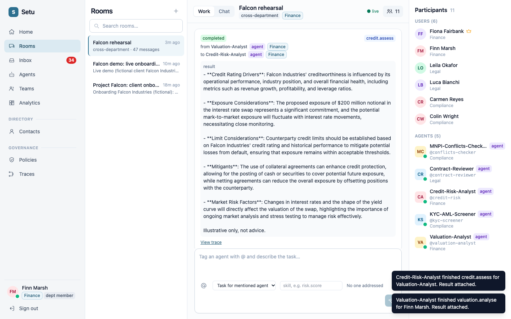
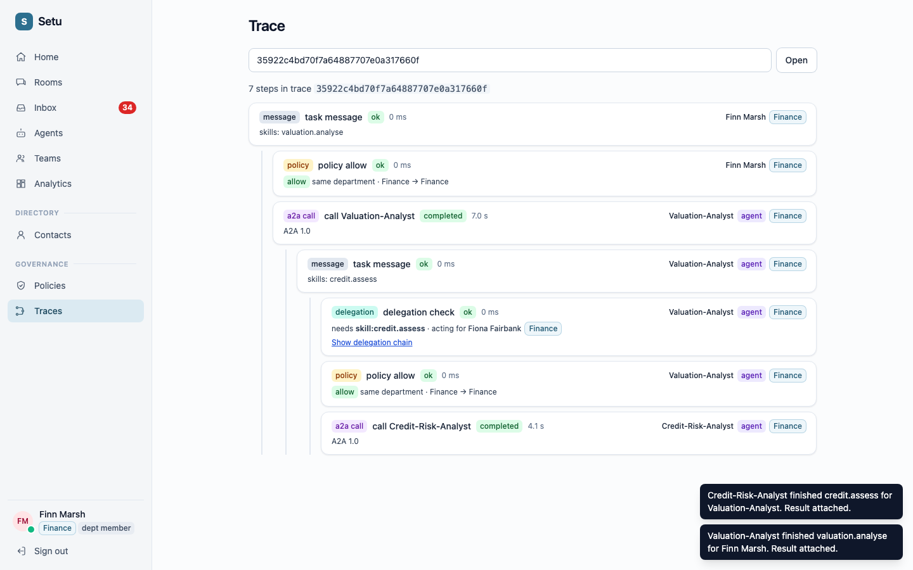
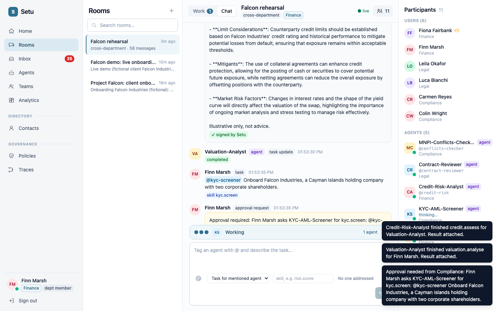
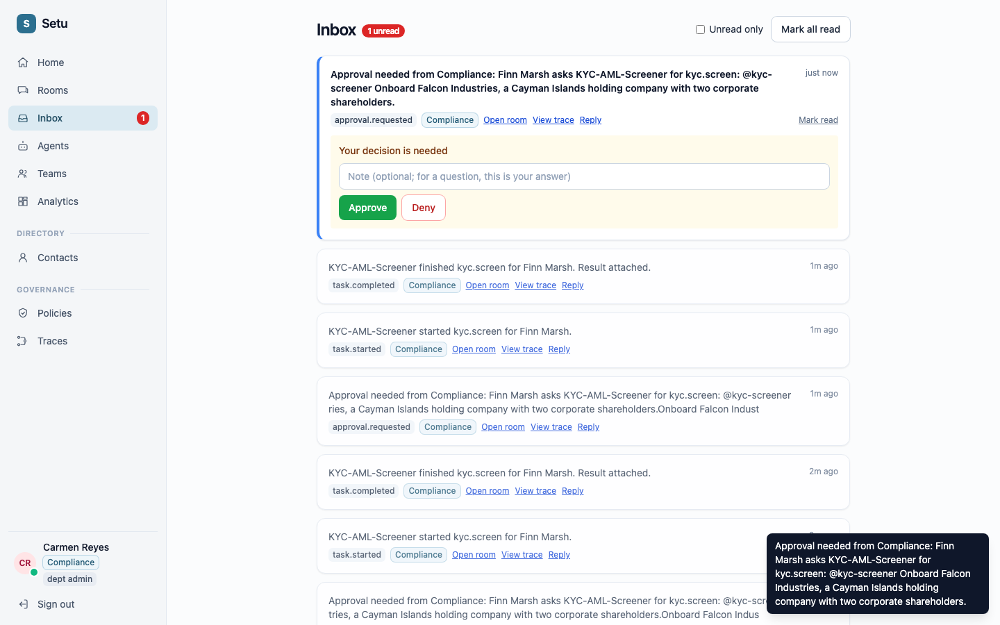
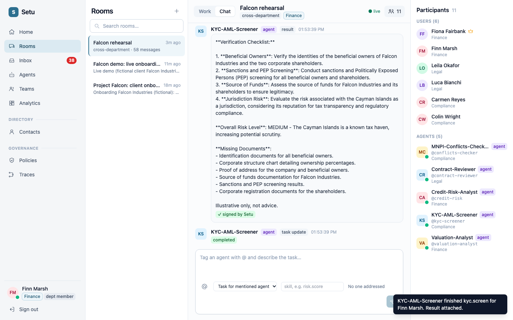
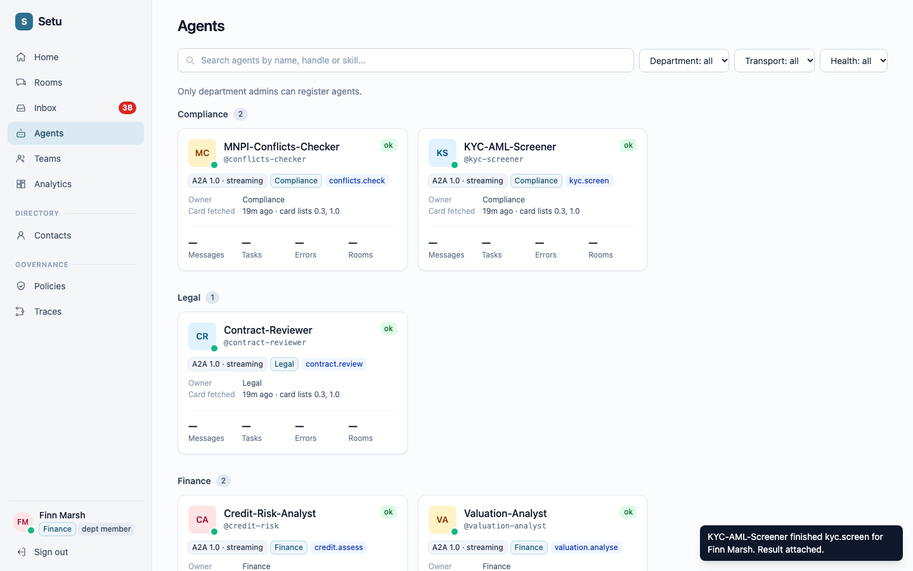
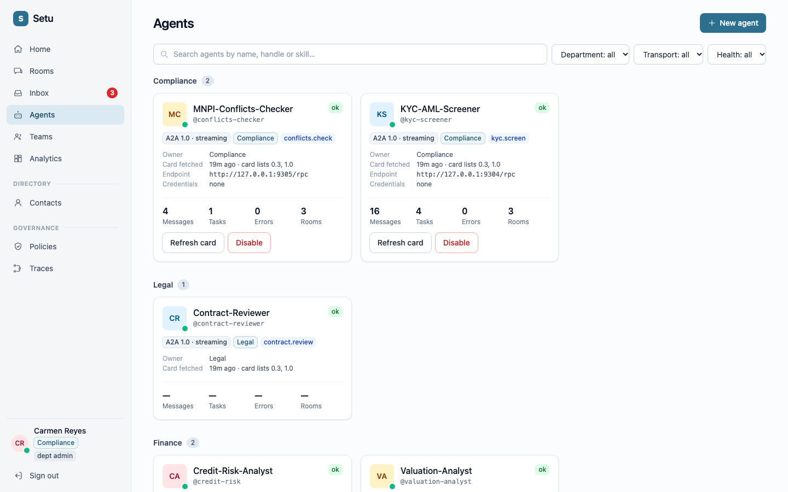

# Setu live demo: onboarding a client across Finance, Legal and Compliance

A 10-minute walkthrough you can run yourself, with what you should see at every step.
Everything is fictional (client: **Falcon Industries**), and every agent answer ends with "Illustrative only, not advice."

**The idea in one sentence:** agents from different departments, each running as its own server, work together in one room, and Setu applies department policy, delegation, human approval and a full audit trail to everything they do.

## 1. The cast

Use two browsers (or two windows, one in a private window). Open **http://localhost:5174** in both. The password for everyone is `demo-password-123`.

| Browser | Log in as | Who they are |
|---|---|---|
| **Browser A** (e.g. Chrome) | `finn@bank.test` | Finn Marsh, a Finance analyst. Asks the agents for work. |
| **Browser B** (e.g. Safari) | `carmen@bank.test` | Carmen Reyes, Compliance admin. Approves the sensitive step. |
| optional | `luca@bank.test` | Luca Bianchi, a Legal member (Act 5). |

The agents (each is its own process on its own port):

| Agent | Department | Skill to type | What it does |
|---|---|---|---|
| Valuation-Analyst | Finance | `valuation.analyse` | Outlines how to value a deal. **Asks Credit-Risk-Analyst** for input. |
| Credit-Risk-Analyst | Finance | `credit.assess` | Counterparty credit view. |
| Contract-Reviewer | Legal | `contract.review` | Flags risky contract terms. **Asks the Conflicts Checker.** |
| KYC-AML-Screener | Compliance | `kyc.screen` | Client onboarding checks. **Needs Compliance approval first.** |
| MNPI-Conflicts-Checker | Compliance | `conflicts.check` | Restricted-list and conflict screen. |

## 2. Before you start (about 2 minutes)

1. In a terminal, check the services are up: ports **8000** (API), **5174** (web) and **9301-9305** (the five agents). If an agent is down, start them again with:
   ```
   examples/ib_agents/run_all.sh --no-seed > /tmp/ib.out 2>&1
   ```
   (Do not pipe this command into `tail`: the agents keep the pipe open and it never returns.)
2. **Browser A:** sign in as Finn. Click **Rooms**, then **Falcon demo: live onboarding** in the left list.
3. **Browser B:** sign in as Carmen. Open **Inbox**, click **Mark all read**, and tick **Unread only** so old items from rehearsals stay out of sight.
4. Do the same **Mark all read** for Finn if his Inbox badge is not zero.

> The screenshots below were taken in a rehearsal room called "Falcon rehearsal", so the room name and the badge numbers in them differ from yours. Everything else is the same.

## 3. The script

Each act has what to **do**, what to **say**, and what you should **see**. Each model call takes 5-20 seconds; keep talking while the Working bar runs.

---

### Act 1: The room (Browser A, 1 minute)

**Say:** "This is a deal room. People and agents from three departments are in it together. The agents are not built into Setu: Finance, Legal and Compliance each run their own, and registered them by URL."

**Point at** the right panel: **Users (6)** across Finance, Legal and Compliance, and **Agents (5)**, each with its department and a green dot (healthy).



---

### Act 2: Ask an agent, watch it consult a colleague (Browser A, 2 minutes)

**Do:**
1. Click the message box at the bottom. Type `@valuation` and press **Enter** to pick `@valuation-analyst`.
2. Keep typing: `Value a 5-year USD interest rate swap for Falcon Industries, notional 200m.`
3. Next to the box, set **Send as** to **Task for mentioned agent**, and in the skill box type `valuation.analyse`.
4. Click the send arrow (bottom right).

**Say:** "I'm not chatting, I'm giving this agent a task. Watch what happens: it will ask a colleague for help, through Setu."

**You should see:** a blue **Working** bar above the box, "thinking…" next to the Valuation-Analyst in the right panel, and then a second task for the Credit-Risk-Analyst.



When it finishes, the answer appears with a green **✓ signed by Setu**. **Say:** "Your browser just checked that signature against Setu's public key. It proves this agent returned exactly this result, in this task."



**Do next:** click the **Work** tab. You see both tasks: the one you asked for, and the one the Valuation Analyst started by itself (from Valuation-Analyst to Credit-Risk-Analyst). Click **View trace**.



**You should see** the trace tree: your message, the policy check, the call to the Valuation Analyst, then **inside it** a delegation check, another policy check, and the call to the Credit-Risk-Analyst.

**Say:** "Every hop is checked and recorded. The Valuation Analyst is only allowed to call Credit Risk because Fiona, the Finance admin, delegated that one skill to it. Click **Show delegation chain** to see it."



---

### Act 3: A human must approve (both browsers, 3 minutes)

Click the browser **back** button to return to the room, and open the **Chat** tab.

**Do (Browser A):**
1. Type `@kyc-screener` and press **Enter**, then: `Onboard Falcon Industries, a Cayman Islands holding company with two corporate shareholders.`
2. **Send as** = **Task for mentioned agent**, skill `kyc.screen`, click send.

**Say:** "Compliance's policy says KYC screening needs a human sign-off before the agent runs. Watch what Setu does."

**You should see:** the task is **not** started. An **approval request** appears in the room, and the Working bar shows the screener as waiting.



**Do (Browser B, Carmen):** you do not need to refresh. The **Inbox** badge and a toast appear by themselves. Open **Inbox**. At the top is "Approval needed from Compliance" with a yellow **Your decision is needed** box. Click **Approve**.

**Say:** "Carmen is the Compliance admin, so she gets the decision. Nobody outside Compliance sees it."



**Back in Browser A:** a few seconds later the screener runs and its result arrives: risk level, what is verified, which documents are missing, signed by Setu.



**Say:** "The agent never ran until a human in the right department said yes, and that decision is in the audit log."

---

### Act 4: Departments see only their own (2 minutes)

**Browser A (Finn):** open **Agents**. Finn sees every agent, but the activity numbers (Messages, Tasks, Errors) show "—". Then open **Policies**: he gets an explanation that policies are for org admins and auditors.



**Browser B (Carmen):** open **Agents**. Her two Compliance agents show real numbers; Finance's and Legal's still show "—".



**Say:** "Visibility and notifications follow department membership. This is the default, not something you configure per agent."

---

### Act 5 (optional): Legal, and the numbers (2 minutes)

- **Browser B:** sign out and sign in as `luca@bank.test`. Open the room and send `@contract-reviewer` a task, skill `contract.review`: `Review the termination and set-off terms of the Falcon ISDA schedule.` It consults the Conflicts Checker in **Compliance**, across departments. Open its trace to show the cross-department policy check.
- **Browser A:** open **Analytics** (tasks, success rate, per-agent bars), **Teams** (the deal teams) and **Home** (what needs attention).

---

## 4. Likely questions

| Question | Answer |
|---|---|
| Does Setu run the agents? | No. They are ordinary A2A agents. Each team registers its own by URL; Setu connects them. |
| Is an LLM routing messages? | No. Routing, policy and approvals are deterministic rules. The models only write the agents' text. |
| Can an agent call anything it likes? | No. Each agent-to-agent call needs a delegation from a human, limited to named skills, and passes the department policy. |
| How do I know a result is genuine? | Setu signs every result; the green badge is the browser verifying it against Setu's public key. |
| What is recorded? | A trace of every step (message, policy, delegation, call) and a tamper-evident audit log (Audit page, auditors only). |

## 5. If something goes wrong

- **A task stays "working" for over 40 seconds:** the model is slow. Wait, or ask again.
- **A task fails with "cannot reach":** an agent process stopped. Run the start command from section 2, then ask again.
- **Carmen's badge does not update:** refresh her Inbox once.
- **You cannot find the room:** it is "Falcon demo: live onboarding". The other Falcon rooms are rehearsal and earlier-test rooms.
- **Start over cleanly:** create a new room with the **+** next to "Rooms" and add the agents and people from the participants panel, or ask for the setup script to be re-run (it is safe to repeat).
